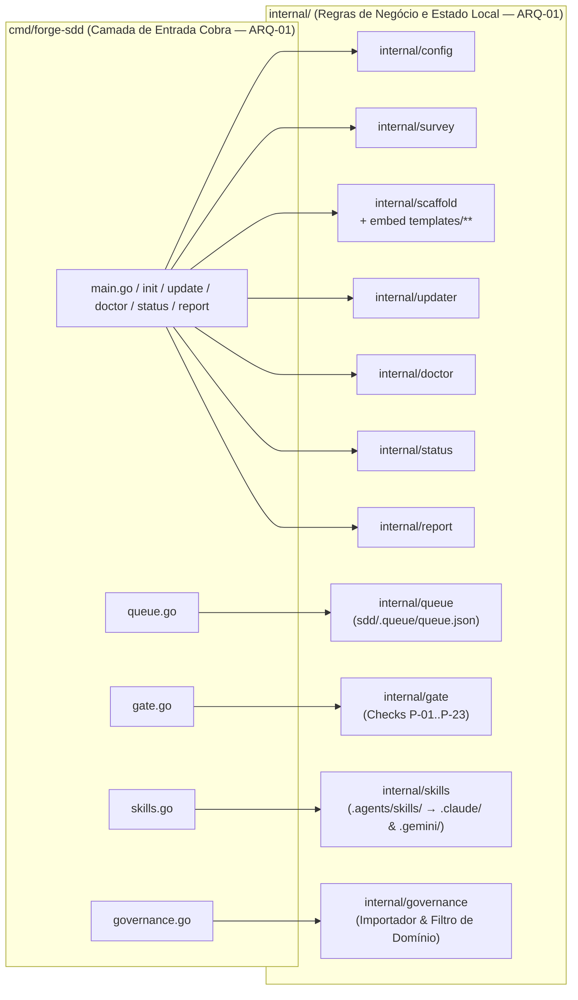

# Módulos — forge-sdd (v3.0.0-beta)

## Diagrama C4 de Containers / Pacotes (`cmd/` vs `internal/`)

---

## Detalhamento dos Módulos

### `cmd/forge-sdd`
**Responsabilidade:** Entrypoint CLI (Cobra); registra subcomandos, faz parse de flags e delega toda lógica de negócio para `internal/*` (`ARQ-01`).
- `main.go`, `update.go`, `doctor.go`, `status.go`, `report.go` — comandos base do ciclo de vida SDD.
- `queue.go` — subcomandos `enqueue`, `next`, `claim`, `complete`, `review`, `list`.
- `gate.go` — subcomando `gate` (`--mode aviso|bloqueio`, `--json`, `--skip-tests`, `--branch`, `--spec`).
- `skills.go` — subcomandos `propose`, `approve`, `sync`, `list`.
- `governance.go` — subcomando `governance import` (`--from`, `--dry-run`).

### `internal/queue`
**Responsabilidade:** Motor determinístico de fila do Builder persistido em `sdd/.queue/queue.json` com escrita atômica.
- Inferência automática de `TaskID`, tamanho (`P`/`M`/`G`), arquivos tocados e dependências (`depends_on`) a partir do markdown da feature.
- Detecção de conflito de arquivos (`CheckConflicts`) para garantir paralelismo seguro entre Builders.
- Ciclo de estados: `queued` → `claimed` → `done` → `review_pending` → `approved` | `rejected`.

### `internal/gate`
**Responsabilidade:** Portão Determinístico Camada A (`FLX-03`).
- `P-01`: Branch fora de `main`/`master` e no padrão `feat/*` ou `fix/*`.
- `P-02`: Existência de spec/discovery/feature vinculada à entrega.
- `P-03`: Limite de linhas por arquivo modificado (`≤ 600` linhas).
- `P-13`: Detecção de segredos hardcoded (chaves AWS, tokens `ghp_`/`sk-`, blocos `PRIVATE KEY`).
- `P-21`: Orçamento de contexto de `sdd/memory/progress.md` (`≤ 1024` bytes).
- `P-23`: Execução de `go test ./...` e `go vet ./...`.

### `internal/skills`
**Responsabilidade:** Motor de Auto-Skills (`DUP-05` Regra de Três / `GOV-03` Fim de Onda).
- `Propose`: Gera rascunho de skill em `.agents/skills/<slug>/SKILL.md` com frontmatter YAML (`status: candidate`, `evidences` ≥ 3) e registra em `sdd/skills/index.md`.
- `Approve`: Promove `status: active`, atualiza `sdd/skills/index.md` e aciona sincronia.
- `Sync`: Propaga skills ativas de `.agents/skills/<slug>/SKILL.md` para `.claude/skills/<slug>/SKILL.md` e `.gemini/skills/<slug>/SKILL.md` conforme `sdd/.sddrc`.

### `internal/governance`
**Responsabilidade:** Importação seletiva e higienizada de regras externas de governança (`ARQ-05`).
- `Inspect`: Escaneia diretórios de governança, bloqueia termos específicos de cliente (Supabase, RDS, Wallet, Omie, Asaas, Pipedrive, AppConfig) e classifica arquivos universais.
- `Import`: Copia itens compatíveis para `.agents/rules/`, `sdd/spec/` e `.github/` sem sobrescrever arquivos existentes.

### `internal/scaffold` & `templates/`
**Responsabilidade:** Renderização da árvore SDD via `embed.FS` (`//go:embed all:templates`) e sincronia com `internal/scaffold/testdata/golden/` (`GOV-01`).
- Inclui `.agents/roles/*.md.tmpl` (5 estações + utilitários), `.agents/rules/sdd-*.md.tmpl`, `.agents/commands/*.md.tmpl`, adaptadores por agente (`claude`, `gemini`, `copilot`, `openai`, `cursor`) e `sdd/spec/`.
