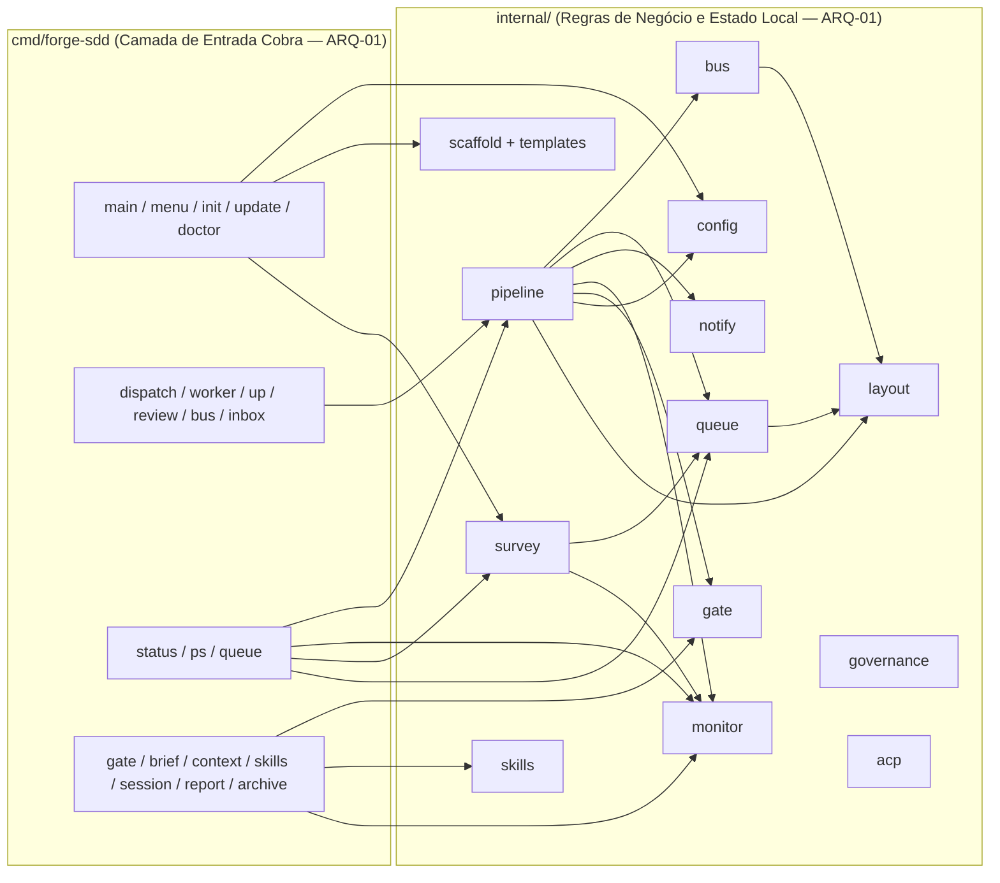

# Módulos — forge-sdd (v5.0.0)

## Diagrama C4 de Containers / Pacotes (`cmd/` vs `internal/`)

---

## Detalhamento dos Módulos

### `cmd/forge-sdd`
**Responsabilidade:** entrypoint Cobra; registra subcomandos, faz parse de flags e delega para `internal/*` (`ARQ-01`). O binário se chama `forge` (ADR-0010).
- Ciclo de vida: `main.go`, `menu.go`, `update_plan.go`, `doctor.go`, `destroy.go`.
- Pipeline: `dispatch.go`, `worker.go`, `up.go`, `review.go`, `bus.go`, `inbox.go`, `pipeline.go`, `attach.go`.
- Visibilidade: `status.go` (`--live`), `ps.go`, `queue.go` (`panel`, drill-down).
- Suporte: `gate.go`, `brief.go`, `context.go`, `skills.go`, `session.go`, `report.go`, `archive.go`, `lessons.go`, `autopilot.go`, `governance.go`, `acp.go`, `rules.go`.
- Modo chat (ADR-0015): `mcp.go` (`forge mcp serve`), `eval.go` (`forge eval`), `agent_models.go` (modelo por papel), `pipeline_goal.go`.

### `internal/layout`
**Responsabilidade:** casa única dos caminhos de `sdd/` e `.forge/` (`DUP-01`, `DUP-04`) e da **iniciativa ativa, deduzida da branch atual** (`ActiveInitiative`, `QueuePath`, `StatusPath`). Valida o id da iniciativa contra path traversal (`SEG-01`).

### `internal/bus`
**Responsabilidade:** barramento de jobs entre as sessões. Um job por arquivo em `.forge/runtime/`, com estados `pending → processing → done | failed` (Builder e Reviewer) e `inbox → archive` (Discovery).
- Tipos de job: `feature_build`, `pr_rework`, `pr_review`.
- `bus.Job` carrega `Initiative`, `TaskIDs`, `PR`, `Attempt` e `ReworkFeedback`: é o vínculo entre o job e as tasks da fila.
- Operações: `Enqueue`, `Claim`, `Complete`, `Fail`, `Renew`, `Recover`, `UpdatePR`, `Requeue`, `List`.

### `internal/queue`
**Responsabilidade:** estado das tasks por iniciativa (`sdd/discovery/<id>/queue.json`, escrita atômica) e filas por estação.
- Estados da task: `queued → building → review_pending → approved | changes_requested`.
- `SetTaskStatuses`: atualiza tasks de uma **iniciativa específica pelo nome**, sem depender da branch atual; idempotente e nunca regride uma task `approved` (ADR-0012).
- `Review` aplica o veredito da Camada B a uma task; `EligibleTasks` respeita `depends_on` e conflito de arquivos.
- `activity.go` registra o que cada estação está fazendo, para o painel.

### `internal/pipeline`
**Responsabilidade:** compõe o pipeline multi-sessão.
- `dispatch.go`, `waves.go`, `worktree.go`: gate pré-build e despacho; ondas paralelas por `**Depende de:**`.
- `worker.go`, `runner.go`, `prompt.go`, `usagelimit.go`: worker de fila, execução do agente e pausa por limite de uso.
- `review.go`: `ApplyVerdict` (aprova, devolve com tentativa incrementada ou escala), propaga o resultado à fila e guarda cópia do veredito em `sdd/discovery/<id>/verdicts/`.
- `deliver.go`, `handoff.go`: entrega de prompts a painéis vivos, reset suave de contexto e cartão de handoff (ADR-0009).
- `archive.go`: auto-archive da iniciativa quando todas as tasks estão `approved`.
- `tmux.go`, `tmuxinstall.go`, `launcher.go`, `liveview.go`, `gitwatch.go`, `agentstate.go`, `preflight.go`: abertura das sessões, contingência de terminal e visão limpa.
- `status_live.go`: painel executivo vivo (`forge status --live`).
- `laco.go`: modo chat, `RunChat` e `Retomar`; o Go é dono do laço, grava o estado e adquire o lock em `.forge/runtime/chat/locks` (ADR-0015, ADR-0016). `leque.go`: um worktree por task paralela e junção (`PrepararLeque`).

### `internal/monitor`
**Responsabilidade:** observação sem efeito colateral.
- `tokens.go`: tokens por janela (Discovery, Builder, Reviewer) e por task; `FormatTokenBadge` (ADR-0009).
- `chat_feed.go`: stream narrativo do worker em linhas de chat (ADR-0011).
- `ps.go`: processos, CPU, RAM e zumbis do projeto. `session_record.go`: telemetria em `sdd/.metrics/`.

### `internal/survey`
**Responsabilidade:** formulário do `init` e TUI da fila: abas **Na Fila** e **Concluídas**, drill-down por task e cartão de detalhe com diagrama do pipeline (`queue_drilldown.go`, `task_detail.go`; ADR-0011).

### `internal/notify`
**Responsabilidade:** notificações do pipeline (PR pronto, escalonamento): inbox da Discovery, toast, e-mail e webhook. Segredos só por variável de ambiente (`SEG-03`).

### `internal/gate`
**Responsabilidade:** Portão Determinístico Camada A (`FLX-03`), `brief` (resumo e `--check` de prontidão) e `context` (contexto mínimo por task).
- Checks `P-xx`: branch fora de `main` (`P-01`), spec existente (`P-02`), limite de linhas por arquivo (`P-03`), segredos (`P-13`), orçamento de `status.md` e memória (`P-21`), `go test` e `go vet` (`P-23`).

### `internal/config`
**Responsabilidade:** `.sddrc`, `forge.json` (agente por sessão, perfis de CLI, níveis de permissão, notificações) e `LoadForgeConfig`.

### `internal/skills` e `internal/governance`
- `skills`: Motor de Auto-Skills (`DUP-05`, `GOV-03`): `Propose`, `Approve`, `Sync`, `List`.
- `governance`: importação seletiva de regras externas (`ARQ-05`), bloqueando termos de cliente.

### `internal/scaffold` & `templates/`
**Responsabilidade:** renderização da árvore SDD via `embed.FS` e sincronia com `internal/scaffold/testdata/golden/` (`GOV-01`). Inclui as skills em `.agents/skills/` (`sdd-concepcao`, `sdd-planejamento`, `sdd-build`, `sdd-governanca`, `sdd-operacao`, hoje material de apoio das 3 sessões; ver `obsoletos.md` da iniciativa 104), as rules em `.agents/rules/`, os comandos e os adaptadores por agente. `migrate.go` migra layouts antigos. `hooks.go`: hook `SessionStart` do doctor, MCP `forge-sdd` e **gravação segura** (`checkSafeTarget`, `writeFileSafe`: recusa link simbólico e destino fora do projeto, grava por temporário e rename; ADR-0018).

### `internal/acp`
**Responsabilidade:** servidor Agent Client Protocol (JSON-RPC 2.0 por stdio e HTTP/SSE) para IDEs externas (`forge acp`). `mcp.go` expõe, por `forge mcp serve`, só a ferramenta `forge_doctor`, somente leitura, com saída saneada (`mcpSaneia`; ADR-0017).

### `internal/harness`
**Responsabilidade:** contratos entre etapas do modo chat com decodificação estrita (`build.go`, `parecer.go`, `harness.go`, `skill.go`) e o **lock por iniciativa** (`lock.go`: `AdquirirLock`, `Renovar`, `Liberar`, lease com recuperação de lock órfão; ADR-0016).

### `internal/doctor`
**Responsabilidade:** `Diagnose` do harness (`harness.go`), somente leitura, usado por `forge doctor --harness` e pela ferramenta MCP `forge_doctor`.
