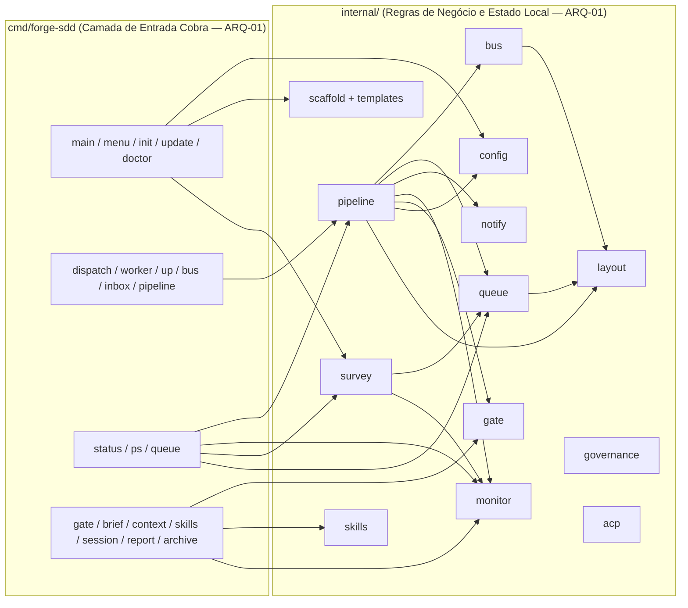

# Módulos — forge-sdd (v4.9.1-beta + iniciativas 89 e 90, na feat/88)

## Diagrama C4 de Containers / Pacotes (`cmd/` vs `internal/`)

---

## Detalhamento dos Módulos

### `cmd/forge-sdd`
**Responsabilidade:** entrypoint Cobra; registra subcomandos, faz parse de flags e delega para `internal/*` (`ARQ-01`). O binário se chama `forge` (ADR-0010).
- Ciclo de vida: `main.go`, `menu.go`, `update_plan.go`, `doctor.go`, `destroy.go`.
- Pipeline: `dispatch.go`, `worker.go` (`worker`, `pipeline pr`, `pr-opened`, `worktree`), `up.go`, `review.go` (`bus review`), `bus.go`, `inbox.go`, `pipeline.go` (`pipeline init`, `autonomy`), `pipeline_goal.go` (`pipeline toca-ai`, `consent`), `attach.go`.
- Visibilidade: `status.go` (`--live`), `ps.go`, `queue.go` (`panel`, drill-down).
- Suporte: `gate.go`, `brief.go`, `context.go`, `skills.go`, `session.go`, `report.go`, `archive.go`, `lessons.go`, `autopilot.go`, `governance.go`, `acp.go`.

### `internal/layout`
**Responsabilidade:** casa única dos caminhos de `sdd/` e `.forge/` (`DUP-01`, `DUP-04`) e da **iniciativa ativa, deduzida da branch atual** (`ActiveInitiative`, `QueuePath`, `StatusPath`). Valida o id da iniciativa contra path traversal (`SEG-01`).

### `internal/bus`
**Responsabilidade:** barramento de jobs entre as sessões. Um job por arquivo em `.forge/runtime/`, com estados `pending → processing → done | failed` (Builder e Reviewer) e `inbox → archive` (Discovery).
- Tipos de job: `feature_build`, `pr_rework`, `pr_review` e `spec_review` (modo avançado: o Reviewer revisa a spec, ADR-0013).
- `bus.Job` carrega `Initiative`, `TaskIDs`, `PR`, `Attempt` e `ReworkFeedback`: é o vínculo entre o job e as tasks da fila.
- Operações: `Enqueue`, `Claim`, `Complete`, `Fail`, `Renew`, `Recover`, `UpdatePR`, `Requeue`, `List`.

### `internal/queue`
**Responsabilidade:** estado das tasks por iniciativa (`sdd/discovery/<id>/queue.json`, escrita atômica) e filas por estação.
- Estados da task: `queued → building → review_pending → approved | changes_requested`, e `blocked` (com motivo; as tasks independentes seguem).
- `queue.json` guarda também `base_branch` (base do PR da iniciativa) e `origem` (`toca-ai` quando a fila nasce do motor do `/toca-ai`). `base.go`: `ResolveBase` (único resolvedor: flag, fila, origem da branch no git, `forge.json`), `SetBase`, `SetOrigem`, `LoadInitiative`, `AddItem`.
- `ParseDependsOn` (`queue.go`) é o único leitor de `**Depende de:**`; `waves.go` o reaproveita.
- `SetTaskStatuses` e `BlockTasks`: atualizam tasks de uma **iniciativa específica pelo nome**, sem depender da branch atual; idempotentes e nunca regridem uma task `approved` (ADR-0012). `CountMatches` avisa quando os IDs do job não casam com a fila.
- `Review` aplica o veredito da Camada B a uma task; `EligibleTasks` respeita `depends_on` e detecta ciclos.
- `activity.go` registra o que cada estação está fazendo, para o painel.

### `internal/pipeline`
**Responsabilidade:** compõe o pipeline multi-sessão.
- `dispatch.go`, `waves.go`, `worktree.go`: gate pré-build e despacho (`--fix` despacha um fix da iniciativa); ondas paralelas por `**Depende de:**`. `specheck.go`: checagem por task antes do build (dependência existente e critério com comando).
- `pr.go`: `OpenPR` (`forge pipeline pr`): Camada A, `git push origin <branch>:<branch>`, PR na base da iniciativa e registro no job; só `git` e `gh`, com argumentos explícitos (`RunGitOrGh`, `SEG-03`).
- `spec.go`: `ApplySpecVerdict` (modo avançado, ADR-0013): aprova e libera a fila, devolve à Discovery ou bloqueia; o Go grava `review-spec.md`.
- `goal.go`: motor do `/toca-ai`: `PreflightGoal`, consentimentos (`RecordConsent`, só a pessoa) e `EnqueueGoalSteps` (um job por etapa, na ordem do DAG).
- `safeguards.go`: tetos de tokens, tempo e jobs por dia (desligados por padrão), `HaltReason` e o arquivo `.forge/runtime/STOP`.
- `worker.go`, `runner.go`, `prompt.go`, `usagelimit.go`: worker de fila, execução do agente e pausa por limite de uso.
- `review.go`: `ApplyVerdict` (aprova, devolve com tentativa incrementada ou escala), propaga o resultado à fila e guarda cópia do veredito em `sdd/discovery/<id>/verdicts/`.
- `deliver.go`, `handoff.go`: entrega de prompts a painéis vivos, reset suave de contexto e cartão de handoff (ADR-0009).
- `archive.go`: `AutoArchiveInitiative` move `sdd/discovery/<id>` para `sdd/archive/discovery/<id>` (idempotente; só na branch da iniciativa e sem task ou fix pendente). Ao aprovar o último job, só a fila com `origem: toca-ai` arquiva sozinha, e só com a branch da iniciativa em uso (`ApplyVerdict` descarta a recusa, que fica silenciosa); nas demais o inbox avisa "pronta para arquivar" (`CheckAndAutoArchive`). `ListArchiveCandidates` alimenta `forge archive --concluidas --dry-run`.
- `tmux.go`, `tmuxinstall.go`, `launcher.go`, `liveview.go`, `gitwatch.go`, `agentstate.go`, `preflight.go`: abertura das sessões, contingência de terminal e visão limpa.
- `status_live.go`: painel executivo vivo (`forge status --live`). `status_short.go`: `FormatShortStatus`, o resumo (até 1,5 KB) que `forge status` imprime quando a saída não vai a um terminal (`--full` mostra tudo).

### `internal/monitor`
**Responsabilidade:** observação sem efeito colateral.
- `tokens.go`: tokens por janela (Discovery, Builder, Reviewer) e por task; `FormatTokenBadge` (ADR-0009).
- `chat_feed.go`: stream narrativo do worker em linhas de chat (ADR-0011).
- `ps.go`: processos, CPU, RAM e zumbis do projeto. `session_record.go`: telemetria em `sdd/.metrics/`.
- `usage.go`: uso real do job lido do evento `result` do log (`ParseJobUsage`, `ReadJobUsage`; sem `result`, `EstimateJobUsage` com `medicao: estimado`) e a soma por iniciativa (`SumUsage`, `ReadSessions`) para `forge report --initiative --jobs` (ADR-0014).

### `internal/survey`
**Responsabilidade:** formulário do `init` e TUI da fila: abas **Na Fila** e **Concluídas**, drill-down por task e cartão de detalhe com diagrama do pipeline (`queue_drilldown.go`, `task_detail.go`; ADR-0011).

### `internal/notify`
**Responsabilidade:** notificações do pipeline (PR pronto, escalonamento): inbox da Discovery, toast, e-mail e webhook. Segredos só por variável de ambiente (`SEG-03`).

### `internal/gate`
**Responsabilidade:** Portão Determinístico Camada A (`FLX-03`), `brief` (resumo e `--check` de prontidão) e `context` (contexto mínimo por task).
- Checks `P-xx`: branch fora de `main` (`P-01`), spec existente (`P-02`), tabela `O que já existe` (`P-03`), segredos (`P-13`), justificativa de dependências novas (`P-14`), exceções da Constituição com prazo (`P-20`), orçamento do `status.md` (`P-21`), rules com frontmatter (`P-23`) e orçamento de contexto das instruções (`P-24`).

### `internal/config`
**Responsabilidade:** `.sddrc`, `forge.json` (agente por sessão, perfis de CLI, níveis de permissão, notificações) e `LoadForgeConfig`.
- `forge.go`: `autonomy` (`normal` ou `advanced`, `IsAdvanced`), `safeguards`, `isolated_confirmed`, `pm_mcp.require_existing_card` (desligado por padrão).
- `forge_profiles.go`: perfis por CLI, `PermissionArgs`, `models` e `efforts` por papel aplicados pelos marcadores `{model}` e `{effort}` (`SessionModelArgs`, `FlagsForCommand`).
- `version.go`: `BinaryVersion`, a única fonte da versão do binário (ldflags).

### `internal/skills` e `internal/governance`
- `skills`: Motor de Auto-Skills (`DUP-05`, `GOV-03`): `Propose`, `Approve`, `Sync`, `List`.
- `governance`: importação seletiva de regras externas (`ARQ-05`), bloqueando termos de cliente.

### `internal/scaffold` & `templates/`
**Responsabilidade:** renderização da árvore SDD via `embed.FS` e sincronia com `internal/scaffold/testdata/golden/` (`GOV-01`). Inclui as 5 skills por estação em `.agents/skills/` (`sdd-concepcao`, `sdd-planejamento`, `sdd-build`, `sdd-governanca`, `sdd-operacao`), as rules em `.agents/rules/`, os comandos e os adaptadores por agente. `migrate.go` migra layouts antigos.

### `internal/acp`
**Responsabilidade:** servidor Agent Client Protocol (JSON-RPC 2.0 por stdio e HTTP/SSE) para IDEs externas (`forge acp`).
