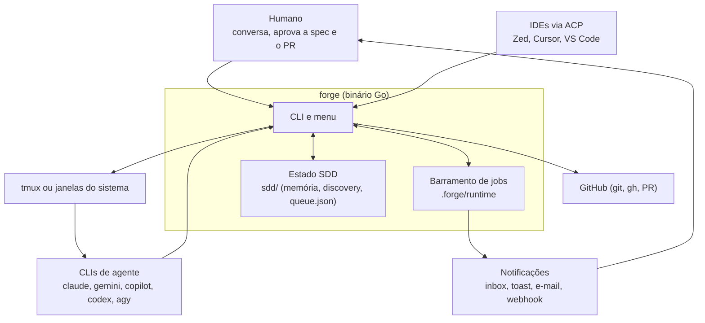
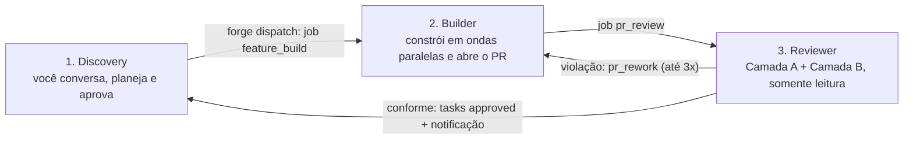
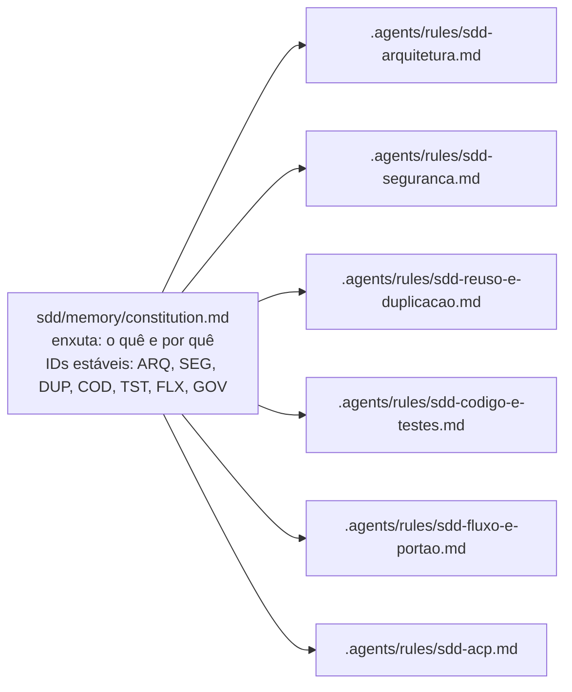

# Overview — forge-sdd (v4.7.7-beta)

CLI Go e framework de **Spec-Driven Development (SDD)** multi-agente. Instala em qualquer projeto uma esteira de **5 estações** (skills por estação), uma **Constituição por IDs estáveis**, o **Portão de Governança em 3 camadas (A/B/C)**, o **Motor de Auto-Skills** e, desde a 4.x, o **Pipeline Multi-Sessão**: Discovery, Builder e Reviewer em sessões de IA separadas, ligadas por um barramento de jobs.

## Índice da Especificação Arquitetural (`sdd/spec/`)
- `overview.md`: visão geral e C4 de contexto.
- `modules.md`: pacotes Go (`cmd/` e `internal/`), templates embarcados e responsabilidades.
- `flows.md`: pipeline multi-sessão, estados do job e da task, tokens e reset, painel e Auto-Skills.
- `concepts.md`: glossário canônico do domínio (`DUP-01` / `GOV-04`).
- `stack.md`: tecnologias, versões, distribuição e layout.
- `decisions.md` e `adr/`: decisões arquiteturais (ADR-0001 a ADR-0012).

---

## C4 de Contexto

---

## As três sessões do pipeline

Cada sessão usa o agente escolhido por ela (`forge.json`). Em modo live, os painéis do tmux ficam abertos e recebem os jobs; em modo headless, cada job abre uma instância nova do agente (ADR-0008).

---

## As 5 estações (skills por estação, ADR-0003)

| Estação | Skill | Papel |
|---|---|---|
| Concepção | `sdd-concepcao` | discovery, critérios, Constituição, C4 |
| Planejamento | `sdd-planejamento` | plano técnico e tasks P/M/G com `depends_on` |
| Build | `sdd-build` | implementação por task, com `forge context` |
| Governança | `sdd-governanca` | revisão somente leitura (Camada B) e `pr-review` |
| Operação | `sdd-operacao` | Líder, painel executivo, inbox e pipeline |

---

## Constituição Distribuída (`GOV-04`)

---

## Escopo do binário (`forge`)
- **Ciclo de vida:** `init`, `update`, `doctor`, `destroy`, `version` e o menu navegável (`forge` sem argumentos).
- **Pipeline:** `up`, `dispatch`, `worker`, `bus`, `inbox`, `review`, `pipeline`, `attach`.
- **Visibilidade:** `status` (`--live`), `ps`, `queue` (`list`, `panel`, `activity`).
- **Contexto e portão:** `brief`, `context`, `gate`, `next-id`.
- **Memória e métricas:** `session`, `report`, `lessons`, `archive`, `autopilot`.
- **Extensões:** `skills`, `governance`, `acp`.

O binário é chamado de `forge` em toda a documentação, nos prompts e nos templates (ADR-0010).
