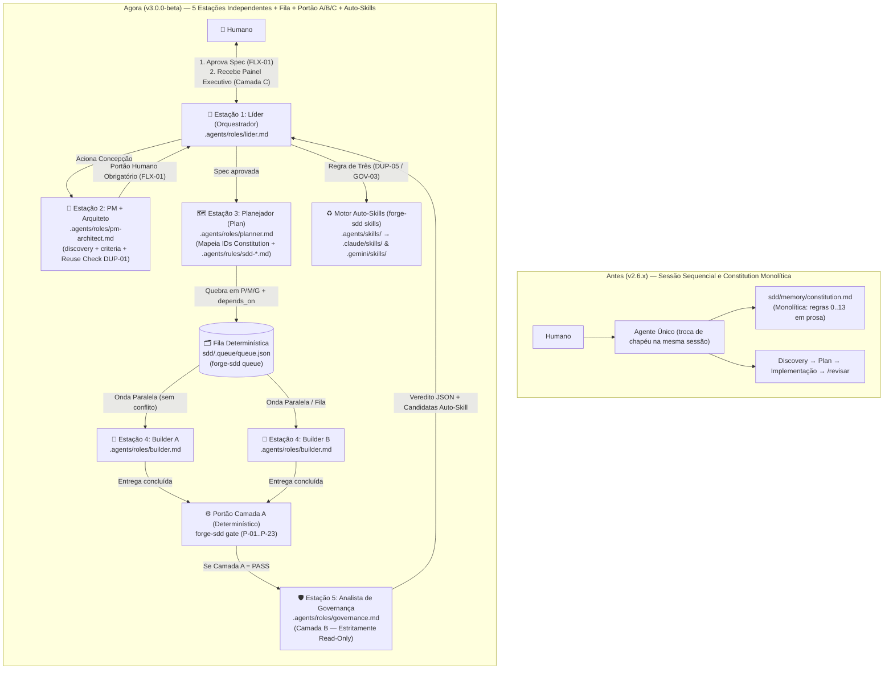
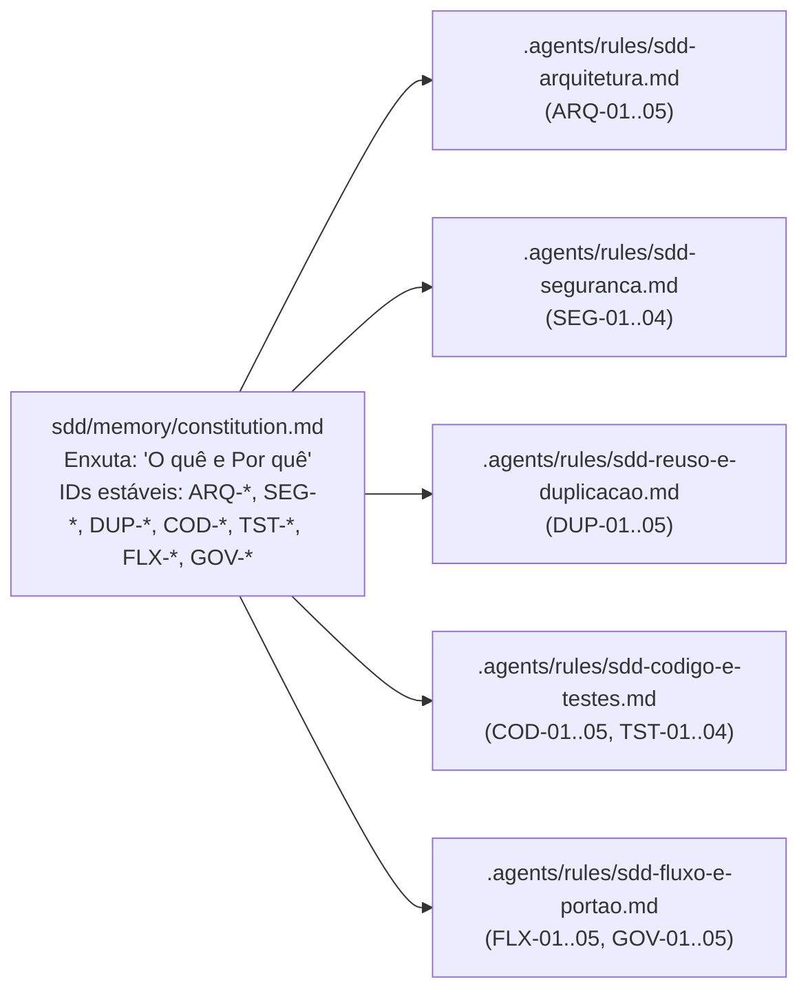

# Overview — forge-sdd (v3.0.0-beta)

CLI Go e framework de **Spec-Driven Development (SDD)** multi-agente com **Orquestração Independente por 5 Estações**, **Constituição Distribuída por IDs estáveis**, **Portão de Governança em 3 Camadas (A/B/C)** e **Motor de Auto-Skills**.

## Índice da Especificação Arquitetural (`sdd/spec/`)
- `overview.md` — visão C4 (Contexto e Containers) e comparativo `v2.6.x` → `v3.0.0-beta`
- `modules.md` — pacotes Go (`cmd/` e `internal/`), templates embarcados e responsabilidades
- `flows.md` — fluxos operacionais (5 estações, fila determinística, Portão A/B/C e Auto-Skills)
- `concepts.md` — glossário canônico do domínio (`DUP-01` / `GOV-04`)
- `stack.md` — tecnologias, versões e layout do projeto
- `decisions.md` & `adr/` — registro de decisões arquiteturais (ADRs)

---

## Evolução Arquitetural: `v2.6.x` vs `v3.0.0-beta`

---

## Constituição Distribuída (`GOV-04`)

---

## Escopo do Binário (`forge-sdd`)
- `forge-sdd init` — inicializa a estrutura Forge-SDD em qualquer repositório
- `forge-sdd update` — atualiza artefatos de agentes preservando dados do usuário (`sdd/memory/`, `sdd/features/`, `sdd/discovery/`)
- `forge-sdd doctor` — verifica integridade dos artefatos SDD e versão instalada
- `forge-sdd status` / `forge-sdd report` — exibe progresso, métricas e telemetria de sessões
- `forge-sdd queue` — gerencia a fila determinística de tarefas do Builder (`sdd/.queue/queue.json`)
- `forge-sdd gate` — executa o Portão Determinístico Camada A (`P-01`, `P-02`, `P-03`, `P-13`, `P-21`, `P-23`)
- `forge-sdd skills` — propõe, aprova, lista e sincroniza Auto-Skills (`DUP-05` / `GOV-03`)
- `forge-sdd governance` — importa e audita padrões genéricos de governança sem acoplamento a cliente
